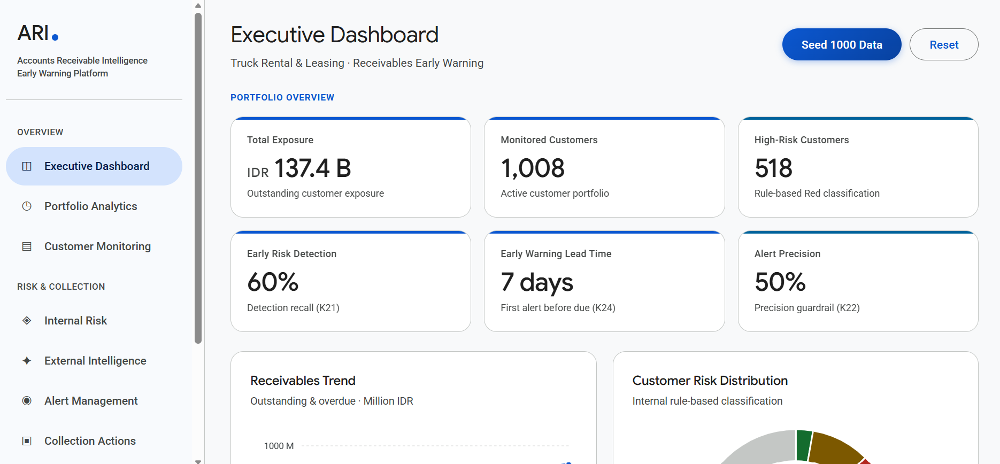
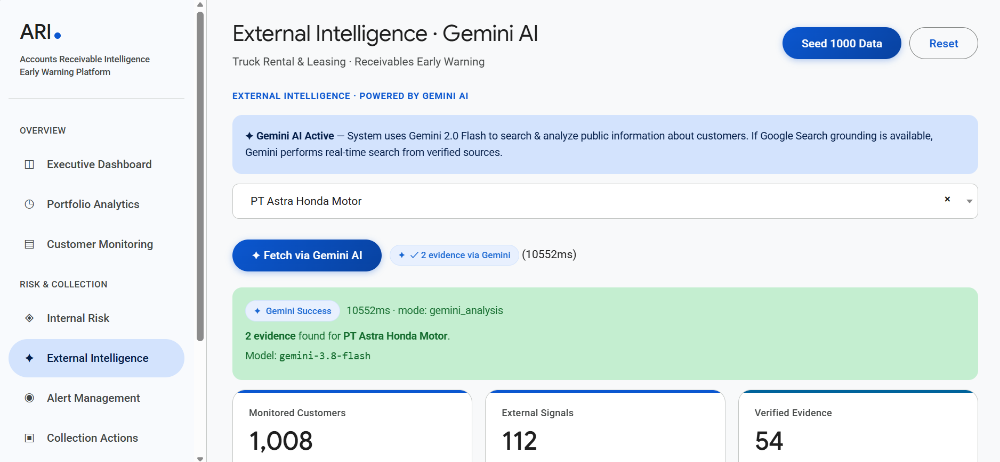

<div align="center">
  <h1>ARI - Accounts Receivable Intelligence</h1>
  <p><strong>AI-Powered Early Warning System for B2B Receivables</strong></p>
  
  [](https://aibuildercup.com/)
  [](https://deepmind.google/models/gemini/flash/)
  [](https://firebase.google.com/)
  [](https://workers.cloudflare.com/)
  
  [Live Demo](https://ar-overdue.firebaseapp.com/) · [Business Requirements Document](docs/BRD-ARI.pdf)
</div>

---

## Overview

B2B companies (especially in truck rental, leasing, and logistics) often face a critical issue: **they only realize a customer is a bad payer after the invoice is overdue.** Traditional credit assessments are done at contract signing, but financial conditions change rapidly. 

**ARI (Accounts Receivable Intelligence)** solves this by acting as a proactive early-warning system. It monitors internal payment behaviors and combines them with external public intelligence (legal records, financial news) using **Gemini AI** to generate risk alerts *before* the invoice hits the due date.

### Why We Built This (Beyond the Competition)
- **For CFOs & Collection Teams:** Reduces Days Sales Outstanding (DSO) and minimizes bad debt write-offs.
- **For Credit Analysts:** Shifts the workflow from *reactive* (chasing overdue payments) to *proactive* (preventing overdue payments through early intervention).
- **Human-in-the-Loop AI:** Gemini acts strictly as an advisor—suggesting collection strategies and summarizing external news—but final contractual actions (like contract termination or repossession) require explicit human approval.

---

## Application Preview

<div align="center">
  
  <br/>
  <i>Executive Dashboard - Real-time Risk Monitoring</i>
</div>
<br/>
<div align="center">
  
  <br/>
  <i>External Intelligence - Gemini AI analyzing public news and legal records</i>
</div>

---

## Tech Stack & Reasons

| Technology | Role | Why We Chose It |
|------------|------|-----------------|
| **Vanilla JS & HTML** | Frontend UI | Ultra-lightweight, zero build steps, ensures fast loading times and easy deployment without complex bundlers. |
| **SQLite (`sql.js`) + LocalStorage** | Database | Runs entirely in the browser via WebAssembly. Perfect for a serverless prototype, providing full SQL capabilities and data persistence across refreshes without needing a backend database. |
| **Google Gemini 3.8 Flash** | AI Engine | Extremely fast, cost-efficient, and capable of parsing unstructured web data into structured JSON risk evidence. |
| **Cloudflare Workers** | API Proxy & Scraper | Secures the Gemini API key (never exposed to the client). Acts as a serverless backend to fetch external data and handle CORS. |
| **Firebase Hosting** | Deployment | Global CDN, SSL out of the box, and integrates seamlessly with the Google Cloud ecosystem. |
| **ApexCharts** | Data Visualization | Provides smooth, interactive, and responsive SVG charts that look modern and professional. |
| **DataTables & Select2** | UI Components | Handles large datasets (1000+ rows) efficiently with client-side pagination, searching, and provides a searchable dropdown (Select2) for better UX. |

---

## System Architecture

```mermaid
graph TD
    A[Browser SPA] -->|Queries/Updates| B[(SQLite / LocalStorage)]
    A -->|Trigger Scrape / AI Request| C[Cloudflare Worker]
    
    C -->|Secures API Key| C
    C -->|Fetch External Data| E[Public News / Legal SIPP / IDX]
    C -->|Prompt + Context| D[Google Gemini 3.8 API]
    
    D -->|Structured JSON Analysis| C
    C -->|Returns Evidence| A
    
    style A fill:#0b57d0,color:#fff,stroke:#041e49,stroke-width:2px
    style C fill:#F38020,color:#fff,stroke:#b35c17,stroke-width:2px
    style D fill:#ea4335,color:#fff,stroke:#b31412,stroke-width:2px
    style B fill:#003b71,color:#fff,stroke:#002b55,stroke-width:2px